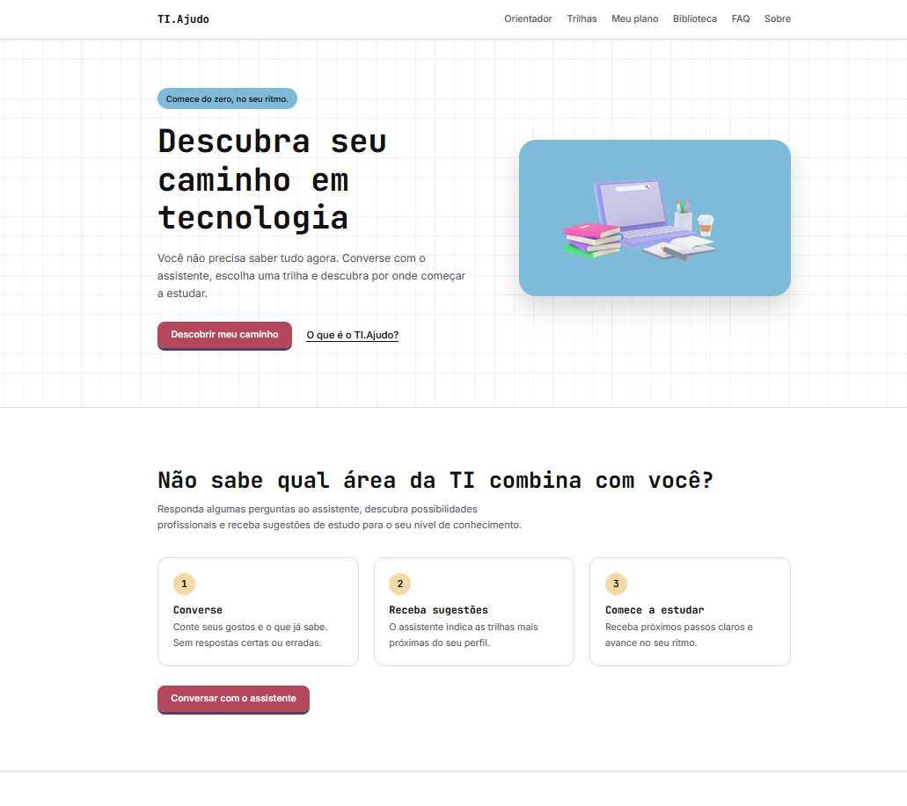
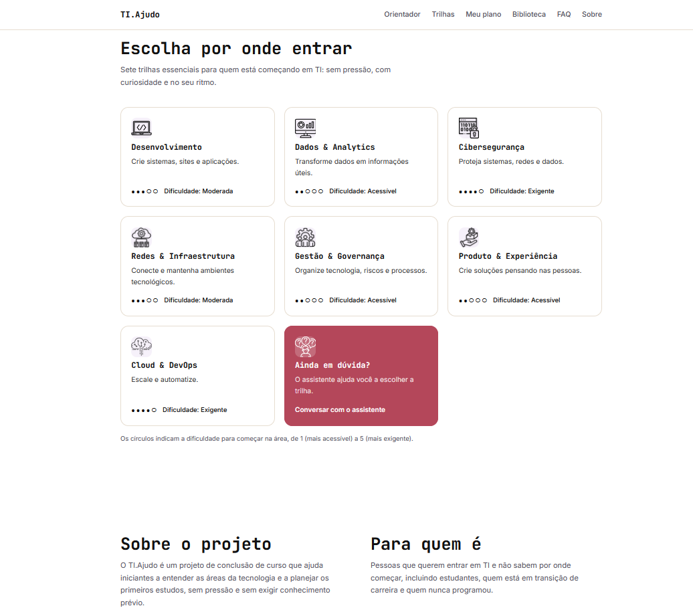
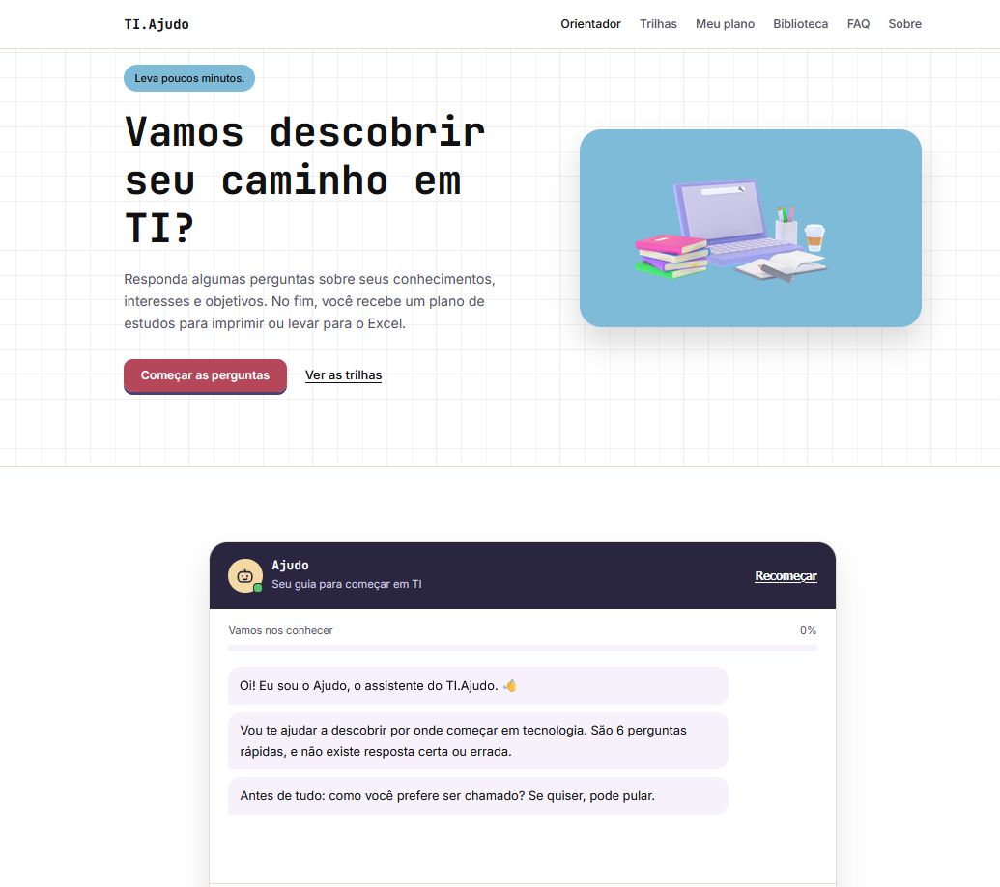
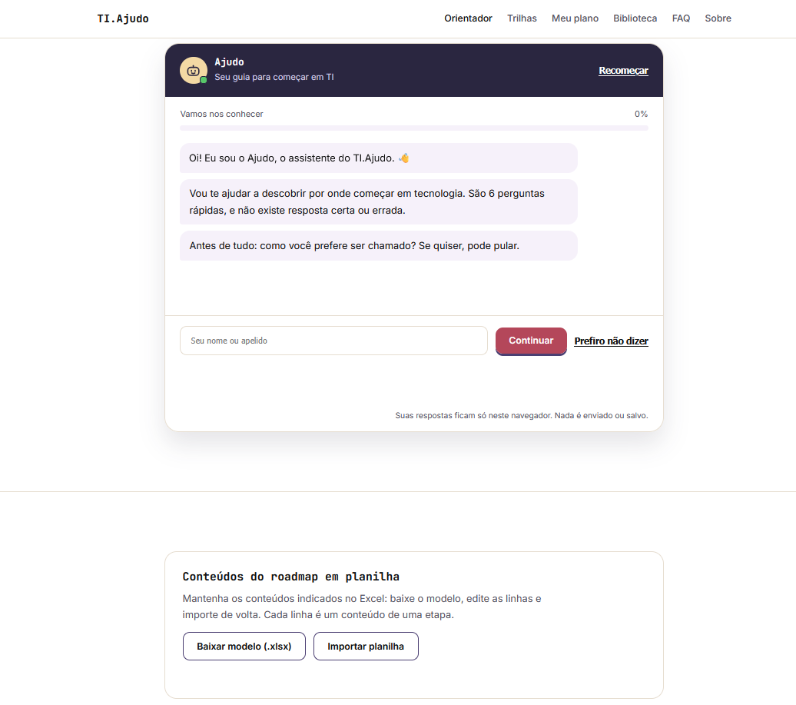
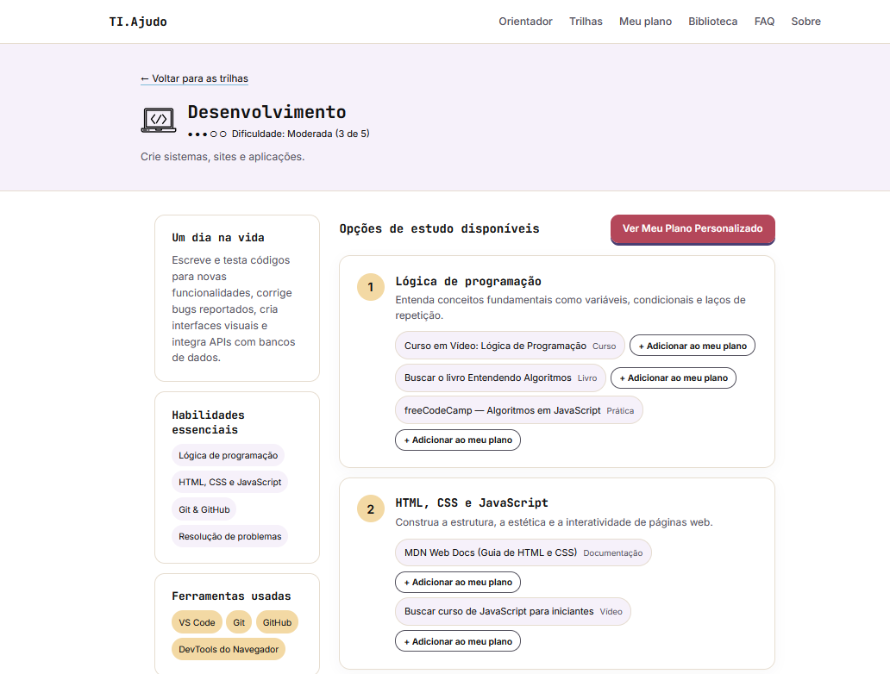
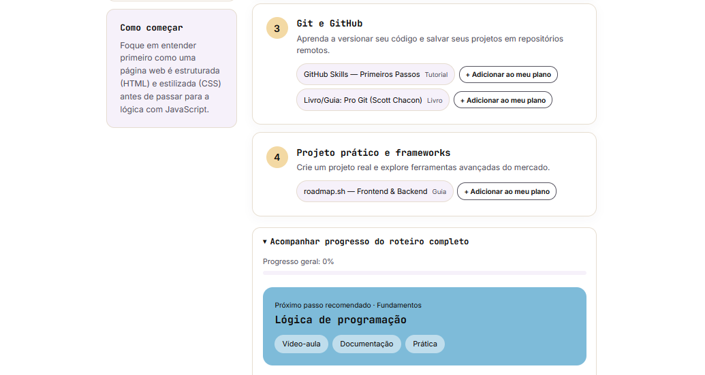
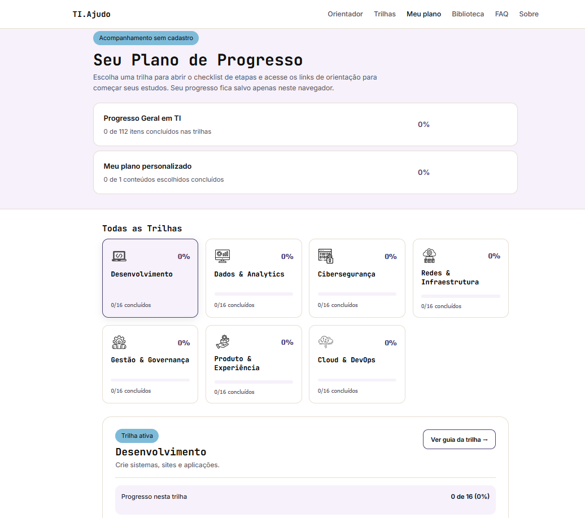
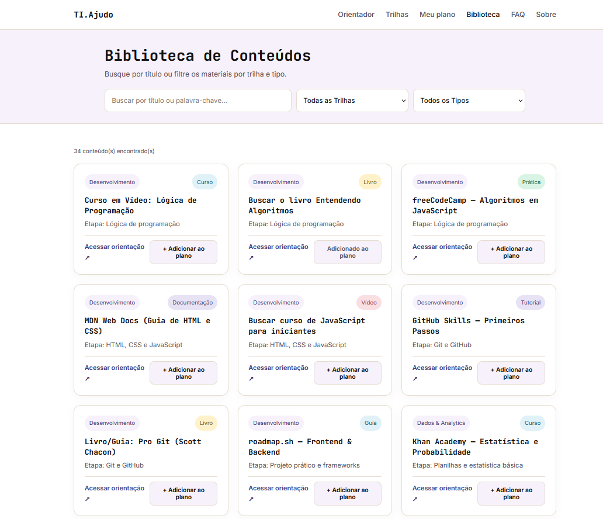
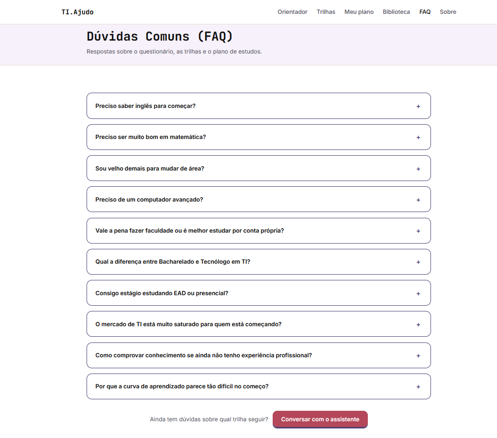

# TI.Ajudo

Aplicação web para ajudar quem está começando em tecnologia a conhecer áreas de TI e organizar os primeiros estudos. Um questionário de perfil recomenda trilhas e apresenta um plano inicial de estudos.

## Executar localmente

Requer Node.js e npm. Na raiz do projeto, instale as dependências e inicie o servidor de desenvolvimento:

```bash
npm install
npm run dev
```

Abra no navegador o endereço informado pelo Vite (por padrão, `http://localhost:5173`).

## Páginas

- `client/index.html` — apresentação do projeto e das sete trilhas.
- `client/assistente.html` — questionário, recomendações e importação de conteúdos por planilha (`.xlsx`, `.xls` ou `.csv`).
- `client/roadmap.html?trilha=dev` — etapas e progresso de uma trilha. Os slugs são `dev`, `dados`, `ciber`, `redes`, `gestao`, `ux` e `cloud`.
- `client/meu-plano.html` — painel do plano e do progresso salvos neste navegador.
- `client/biblioteca.html` — busca e filtros de materiais por trilha e tipo.
- `client/faq.html` — respostas a dúvidas sobre o questionário, as trilhas e o plano.

## Interfaces

### Página inicial




### Assistente




### Roadmap




### Meu plano



### Biblioteca



### FAQ



## Como funciona

O questionário considera interesses, preferências de trabalho, relação com matemática e lógica, nível informado e tempo disponível para estudo. Regras de pontuação ordenam as trilhas e mostram as três mais próximas das respostas. O plano exibido corresponde à trilha mais bem classificada.

As recomendações são heurísticas locais. A versão atual não aplica testes técnicos nem usa IA generativa. O progresso dos roadmaps é salvo no armazenamento local do navegador; as respostas do questionário não são enviadas a um servidor.

Na página do assistente, é possível baixar um modelo de planilha e importar conteúdos para substituir as etapas das trilhas durante a sessão.

## Tecnologias

- HTML, CSS e JavaScript.
- [Vite](https://vite.dev/) para desenvolvimento e build.
- [SheetJS](https://sheetjs.com/) para leitura e geração de planilhas.

## Estrutura do projeto

- `client/*.html` — páginas da aplicação.
- `client/src/js/data/` — perguntas, catálogos e conteúdos dos roadmaps.
- `client/src/js/engine/` — recomendação e regras de progresso.
- `client/src/js/ui/` — interfaces do questionário, resultados, planilhas e roadmaps.
- `client/src/styles/` — estilos globais, componentes e páginas.
- `docs/` — requisitos e documentação da arquitetura.

## Equipe

Projeto desenvolvido por estudantes de Ciência da Computação do Centro Universitário Braz Cubas:

- Gabriel Anastácio Pereira
- Karen Gabrielle Justino
- Miguel Pereira

## Licença

Licenciado sob a MIT License. Consulte [LICENSE](LICENSE).
